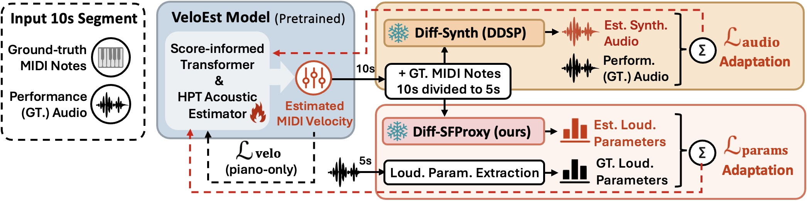

<div align="center">

### Beyond Piano: Cross-Instrument MIDI Velocity Estimation via Differentiable SoundFont Proxies

**ISMIR 2026** · Zhanhong He · Hanyu Meng · David Defeng Huang · Roberto Togneri

[](https://zhanh-he.github.io/sfproxy-velocity-estimation/)
[](demo/paper/2026_ISMIR_Velo_Beyond_Piano_Camera_Ready.pdf)
[](https://arxiv.org/abs/2608.08985)
[](https://github.com/zhanh-he/sfproxy-velocity-estimation/releases/tag/v0.1.0-inference)
[](demo/analysis/README.md)

</div>

**Diff-SFProxy adapts a piano-trained MIDI velocity estimator to new instruments using performance audio and aligned note events.** Instead of reconstructing every waveform detail, a differentiable SoundFont proxy supervises note intensity and attack through two acoustic cues. We study guitar adaptation on [GAPS](https://zenodo.org/records/13962272) and [François Leduc](https://zenodo.org/records/10984521), alongside piano evaluation on MAESTRO and SMD.

<p align="center">
  <br>
  <sub>Same note pitch and timing; velocities adapted to the target instrument.</sub>
</p>

## Listen, try, or reproduce

| Goal | Start here |
| --- | --- |
| **Hear the difference** | [Interactive demo](https://zhanh-he.github.io/sfproxy-velocity-estimation/): 24 twenty-second excerpts across four datasets, with matched audio and colorized MIDI. |
| **Estimate velocities** | [Inference guide](scripts/README.md#inference-comparison) and [bundled piano/guitar checkpoints](score_hpt/checkpoints/README.md). Supply an aligned audio/MIDI pair. |
| **Train or adapt a model** | [SoundFont proxy](diff-sfproxy/README.md), [VeloEst adaptation](score_hpt/README.md), and [experiment launchers](scripts/README.md). |

## How it works

VeloEst reads performance audio and aligned MIDI notes, then predicts note velocities. During adaptation, VeloEst is updated through a **frozen differentiable backend**:

- **Diff-Synth (DDSP baseline):** supervise reconstructed audio in the waveform domain.
- **Diff-SFProxy (ours):** supervise **pitch-conditioned harmonic energy (PHE)** and **onset-window spectral flux (OSF)**, focusing on intensity and attack rather than full waveform reconstruction.

<p align="center">
  <br>
  <sub>Paper method overview. The main comparison uses a 10 s frontend window and a 5 s backend crop.</sub>
</p>

## Run the bundled piano and guitar models

Clone the working release branch:

```bash
git clone --branch backup https://github.com/zhanh-he/sfproxy-velocity-estimation.git
cd sfproxy-velocity-estimation
```

Install Python 3.11 and the independent [inference requirements](scripts/requirements-inference.txt) following the [inference guide](scripts/README.md#inference-comparison). The included [environment snapshot](score_hpt/environment.yml) records the historical Linux/CUDA training setup; it is not a minimal or portable installer.

With your performance recording and its **aligned piano MIDI**, run:

```bash
python scripts/infer_compare.py \
  --audio /path/to/performance.wav \
  --midi /path/to/aligned_score.mid \
  --out /path/to/comparison
```

For guitar, select the two bundled 5 s adapted checkpoints. This example also
uses audio and aligned MIDI already in the repository:

```bash
python scripts/infer_compare.py \
  --audio demo/docs/assets/cases/gaps-019-100/reference.mp3 \
  --midi demo/docs/assets/cases/gaps-019-100/reference.mid \
  --out /tmp/veloest-guitar --checkpoint-set guitar
```

The piano default writes `flat64.mid`, `veloest.mid`, and `diffsfproxy.mid`;
the guitar set also writes `diffsynth.mid`. Both write `notes.csv`,
`comparison.svg`, and `summary.json`. Note pitch and timing are preserved;
only velocities change. The [inference release](https://github.com/zhanh-he/sfproxy-velocity-estimation/releases/tag/v0.1.0-inference)
mirrors the original piano-pretrained and two guitar-adapted checkpoints.
This is **score-informed velocity estimation, not audio-to-MIDI transcription**.

- No proxy backend checkpoint or training step is needed for this inference path.
- Add `--reference-velocities` only if the input MIDI has verified performance velocities.
- Add `--sfz /path/to/instrument.sfz` to render the output. Rendering additionally needs the complete SFZ instrument, [`sfizz_render`](diff-sfproxy/README.md#the-extra-renderer-dependency-sfizz_render), and `ffmpeg`.

## Repository layout

| Folder | Contents |
| --- | --- |
| [`score_hpt/`](score_hpt/README.md) | Onset-assisted VeloEst frontend, bundled piano and guitar weights, adaptation, inference, evaluation, and tests. |
| [`diff-sfproxy/`](diff-sfproxy/README.md) | SoundFont teacher-data export, note-wise proxy training, feature extraction, and velocity-recovery evaluation. |
| [`diff-synth/`](diff-synth/README.md) | Piano/guitar DDSP comparison backends and upstream acknowledgements. |
| [`demo/`](demo/README.md) | Listening site, paper figures and manuscript, aggregate tables, and analysis evidence. |
| [`scripts/`](scripts/README.md) | Inference entry point and experiment launchers for local machines and Kaya. |

The implementations retain the research layout so existing imports and experiment paths keep working. Large datasets, SoundFont sample libraries, and frozen backend training checkpoints are external. For the main adaptation comparison, explicitly set `backend.backend_segment_seconds=5`; some inherited configurations still default to 2 s.

## Results and reproducibility

The [online demo](https://zhanh-he.github.io/sfproxy-velocity-estimation/) compares the original recording, Flat 64, Diff-Synth, and Diff-SFProxy on the same notes and listening window. These selected examples are **not** aggregate evaluations. Guitar datasets lack verified note-velocity labels; the paper therefore evaluates rendered loudness correlations rather than guitar velocity MAE. See the [listening-case inventory](demo/analysis/LISTENING_CASES.md) for excerpt sources and scores.

The reported tables are transcribed from the camera-ready paper. Recovered 5 s guitar models support the listening examples, but the exact run behind the paper's **FL Diff-SFProxy r_BSSL = 0.777** remains unidentified. The [recovery record](demo/analysis/GUITAR_RESULT_RECOVERY.md) and [provenance inventory](demo/analysis/PROVENANCE.md) separate verified files from unresolved release items. Do not treat an example checkpoint as a reproduction of the full paper table.

To rebuild the paper-result graphics or serve the listening site locally:

```bash
python3 demo/analysis/build_figures.py
python3 -m http.server 8000 --directory demo/docs
```

Open `http://localhost:8000/`. The website is published from `backup`; `main` is not updated by this presentation pass. See the [release-readiness audit](demo/analysis/RELEASE_READINESS.md) for the clean-environment inference check, guitar-weight provenance, FL result gap, and component-specific licensing evidence.

## Citation and acknowledgements

We release this work under CC BY 4.0 license. If you find our work or this repository useful for your research, please consider citing our paper. Feel free to contact zhanh.he.uwa@gmail.com

```bibtex
@inproceedings{he2026beyond,
  author = {Zhanhong He and Hanyu Meng and David Defeng Huang and Roberto Togneri},
  title = {Beyond Piano: Cross-Instrument MIDI Velocity Estimation via Differentiable SoundFont Proxies},
  booktitle = {Proceedings of the International Society for Music Information Retrieval Conference},
  year = {2026},
  url = {https://arxiv.org/abs/2608.08985}
}
```

VeloEst builds on our earlier work - [Score-Informed AMT](https://github.com/zhanh-he/score-informed-amt). For DDSP, see the [frontend acknowledgements](score_hpt/README.md#acknowledgement), [DDSP attribution](diff-synth/README.md).
